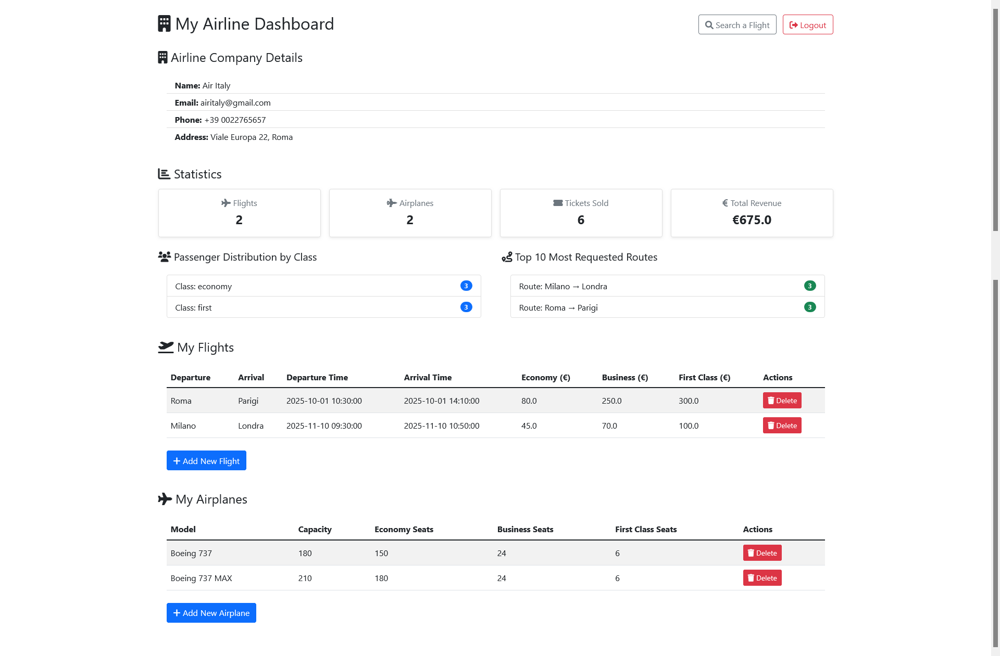
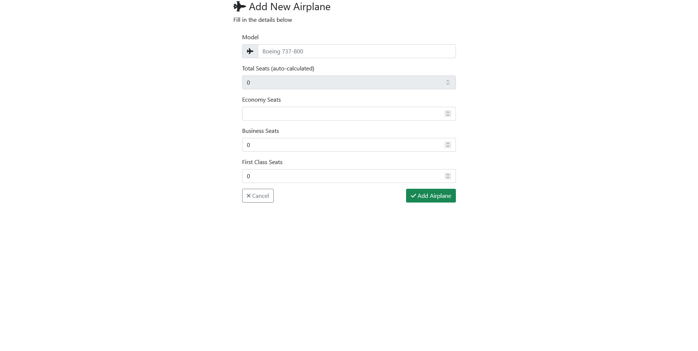
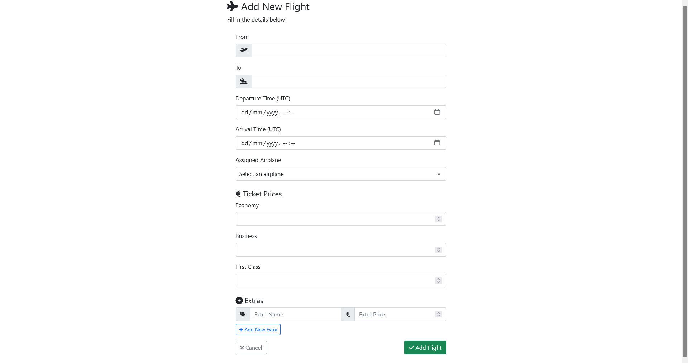
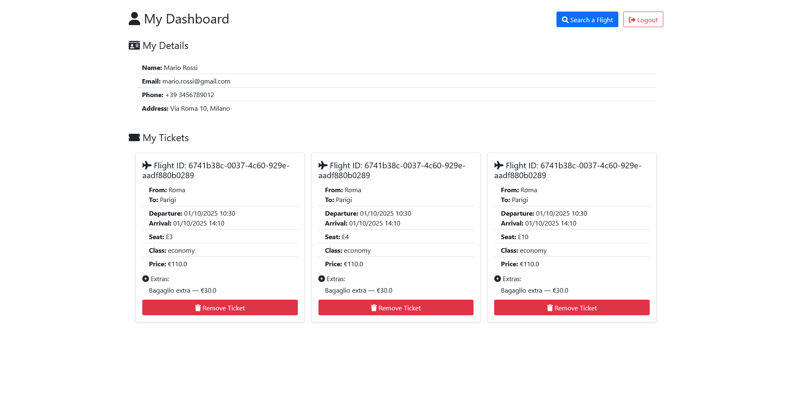
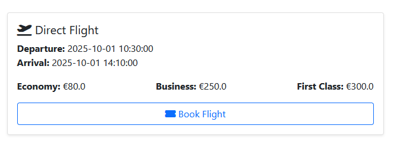
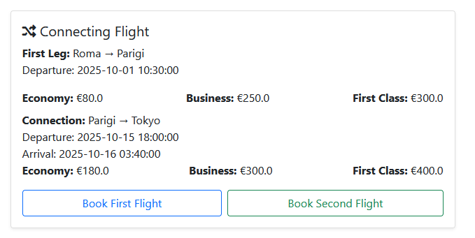
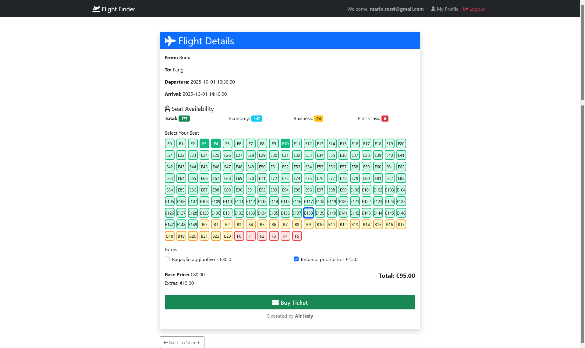

**01/09/2025**

**Gruppo composto da:**

- Gumiero Filippo - 897314

- Surian Raoul - 886732

- Hysenaj Diolen - 876452

# **Introduzione**

La presente relazione ha l’obiettivo di descrivere il progetto realizzato dal nostro gruppo per il corso di Basi di dati. Il documento è strutturato nel seguente modo: 

- Descrizione ad alto livello delle funzionalità supportate dalla web application

- Descrizione delle scelte relative alla progettazione del database, supportate da opportune rappresentazioni grafiche

- Dettagli implementativi relativi alla realizzazione del backend e del frontend

- Ruolo di ciascun componente del gruppo nella realizzazione del prodotto finale****

# **Funzionalità principali**

## **Navbar con logo e tasti login e register**:

Il logo, se cliccato, reindirizza alla pagina principale, ovvero per la ricerca dei voli:


I tasti login e register indirizzano alle relative pagine:


## **Registrazione dell’utente**:


Nella pagina ”Register”, gli utenti possono completare il processo di registrazione fornendo delle informazioni obbligatorie:

+ Email, Password

+ Checkbox per specificare se ci si vuole registrare come compagnia aerea o come un normale utente. In caso affermativo, viene richiesto il nome della compagnia aerea.

 Inoltre vengono richieste delle informazioni facoltative:

+ Numero di telefono, indirizzo e nel caso non si selezioni il checkbox anche nome e cognome del passeggero

## **Ruoli**:

A seconda del ruolo scelto, gli utenti potranno compiere azioni diverse all’interno della piattaforma.

+ **Compagnie aeree:**  Le compagnie possono aggiungere o rimuovere aerei a loro disposizione, aggiungere o rimuovere delle tratte servite dai propri aerei e visualizzare le statistiche riguardanti il numero di aerei, il numero di tratte disponibili, il numero di biglietti venduti, il guadagno totale, le tratte maggiormente richieste e la distribuzione dei biglietti venduti divisa per classi(economy, business e first class).

+ **Passeggeri:** I passeggeri possono comprare biglietti aerei. L’applicazione permette l’ordinamento delle alternative possibili in base a vari parametri (costo, durata, numero di soste, etc.). Una volta selezionata un’alternativa, i passeggeri possono procedere all’acquisto dei biglietti in una pagina apposita.

## **Login:** 

Gli utenti registrati possono accedere alla loro area riservata effettuando il login tramite l’inserimento delle seguenti credenziali: Email e Password. Dopo aver inserito delle credenziali valide, l’utente sarà autorizzato ad accedere alla sua area personale, dove avrà accesso a delle funzionalità ulteriori specifiche al suo ruolo (“Compagnia aerea” o “Passeggero”) all’interno dell’applicazione. L’autenticazione con le credenziali corrette è essenziale per garantire la privacy e la sicurezza delle informazioni personali di ciascun utente.


## **Airline Dashboard** 

Dopo il login l’utente (Airline Company)  entra in un **dashboard completo** dove può:

1. Visualizzare i dettagli della compagnia
2. Controllare statistiche dei voli, passeggeri e revenue
3. Gestire Voli (aggiungere / eliminare)
4. Gestire aerei (aggiungere/eliminare)
5. Analizzare i dati di passeggeri e rotte più richieste 



## **Schermata di aggiunta di un Aereo**

Un Operatore può aggiungere un nuovo aereo alla propria flotta indicandone il modello e la sua capacità.



## **Schermata di aggiunta di un volo**

Un Operatore può aggiungere un nuovo volo specificando gli aeroporti di partenza e arrivo (una tratta), i relativi orari di partenza e arrivo.
Oltre che selezionare l'aereo che deve effettuare il volo e assegnare i costi alle 3 tipologie di biglietto (economy, business e first class).

E' possibile inoltre aggiungere degli extra al volo.



## **User Dashboard**

Dopo il login l’utente (Passeggero) entra in un **dashboard completo** dove può:

1. Visualizzare i dettagli del proprio profilo
2. Visualizzare i biglietti prenotati con le relative informazioni e eliminarli. 



## **Schermata di ricerca**

È la pagina principale del sito. Da qui è possibile ricercare i voli disponibili indicando la località di partenza e di arrivo. È inoltre possibile filtrare il risultato indicando una data minima (data odierna di default) e una data massima per la partenza del volo, richiedere solo voli diretti e infine indicare il range di prezzo desiderato.

È possibile ordinare i risultati a seconda del prezzo crescente/decrescente, della data di partenza/arrivo o della durata del volo.


 Esempio volo diretto:



Esempio volo con scalo:



## **Schermata di prenotazione**

Se si ha eseguito l’accesso come passeggero, si possono prenotare dei biglietti per il volo selezionato che potranno essere visualizzati nella pagina profilo. È possibile selezionare il posto desiderato. Se contemporaneamente un altro utente dovesse comprare un biglietto, il posto risulterà occupato senza dover aggiornare la pagina:



# **Progettazione**

## **Progettazione concettuale e logica del DB**

**Modello a oggetti:** Dall’analisi dei requisiti del progetto è emersa la seguente rappresentazione a oggetti del sistema da implementare:


**Modello relazionale:** La conversione nel modello relazionale produce il seguente diagramma:


### **Query utilizzate**

Le query principali sono : 

```search_flight```

Questa query chiede al database tutti i voli dalla tabella flights che rientrano nei filtri indicati dall'utente. Sono due query distinte, una chiede solo i voli diretti ovvero dove departure_airport e destination_airport sono quelli indicati dall'utente mentre l'altra chiede solo i voli con scalo ovvero  quelli dove departure_airport del primo volo e destination_airport del secondo volo sono quelli indicati dall'utente, con un minimo di due ore di differenza tra arrival_time del primo volo e departure_time del secondo volo.

```SQL
-- Voli diretti
SELECT 
   f1.id AS flight1_id,
   NULL AS flight2_id
FROM 
   flights f1
WHERE 
   f1.departure_airport = %(departure)s
   AND f1.destination_airport = %(arrival)s
   AND f1.departure_time >= %(departure_date)s
   {AND f1.arrival_time <= %(arrival_date)s} -- opzionale
   AND (
      f1.economy_price BETWEEN %(min_price)s AND %(max_price)s OR
      f1.business_price BETWEEN %(min_price)s AND %(max_price)s OR
      f1.first_class_price BETWEEN %(min_price)s AND %(max_price)s
   )
ORDER BY
   {ORDINAMENTO}
UNION
-- Voli con uno scalo (solo se direct_flight = False)
SELECT 
   f1.id AS flight1_id,
   f2.id AS flight2_id
FROM 
   flights f1
JOIN 
   flights f2 ON f1.destination_airport = f2.departure_airport
WHERE 
   f1.departure_airport = %(departure)s
   AND f2.destination_airport = %(arrival)s
   AND f1.departure_time >= %(departure_date)s
   AND f2.departure_time >= f1.arrival_time + INTERVAL '2 hours'
   {AND f2.arrival_time <= %(arrival_date)s} -- opzionale
   AND (
      (f1.economy_price + f2.economy_price BETWEEN %(min_price)s AND %(max_price)s) OR
      (f1.business_price + f2.business_price BETWEEN %(min_price)s AND %(max_price)s) OR
      (f1.first_class_price + f2.first_class_price BETWEEN %(min_price)s AND %(max_price)s)
   )
ORDER BY
   {ORDINAMENTO}
```

```get_airline_statistics```

Questa serie di query fornisce le statistiche principali riguardanti una compagnia aerea specifica, come il numero di voli, il numero di aerei, il numero di biglietti venduti e i ricavi totali.

```SQL
-- Numero di voli della compagnia
SELECT COUNT(*) AS n_flights
FROM flights
WHERE airline_id = %(airline_id)s;

-- Numero di aerei della compagnia
SELECT COUNT(*) AS n_airplanes
FROM airplanes
WHERE airline_id = %(airline_id)s;

-- Numero di biglietti venduti dalla compagnia
SELECT COUNT(*) AS n_tickets
FROM tickets t
JOIN flights f ON t.flight_id = f.id
WHERE f.airline_id = %(airline_id)s;

-- Ricavi totali della compagnia
SELECT COALESCE(SUM(t.price), 0) AS total_revenue
FROM tickets t
JOIN flights f ON t.flight_id = f.id
WHERE f.airline_id = %(airline_id)s;
```

```get_airline_top_routes```

Questa query restituisce le rotte principali di una compagnia aerea, ovvero quelle con il maggior numero di passeggeri.

```SQL
SELECT 
    f.departure_airport,
    f.destination_airport,
    COUNT(t.id) AS passengers
FROM 
    flights f
JOIN 
    tickets t ON f.id = t.flight_id
WHERE 
    f.airline_id = %(airline_id)s
GROUP BY 
    f.departure_airport,
    f.destination_airport
ORDER BY 
    passengers DESC
LIMIT %(limit)s;
```

```get_airline_class_distribution```

Questa query restituisce il numero di biglietti acquistati per ciascuna classe.

```SQL
SELECT 
    t.ticket_class,
    COUNT(t.id) AS count
FROM 
    tickets t
JOIN 
    flights f ON t.flight_id = f.id
WHERE 
    f.airline_id = %(airline_id)s
GROUP BY 
    t.ticket_class;
```

```get_remaining_ticket_count_by_flight```

Queste query ritornano : 
+ Il numero di biglietti venduti per ciascuna classe per un volo specifico
+ Il numero totale di biglietti venduti per il volo
+ Le informazioni sui posti dell'aereo associato al volo

Queste 3 query vengono utilizzate nel codice per ritornare il numero rimanente di biglietti per ogni classe

```SQL
SELECT
    t.ticket_class,
    COUNT(*) AS sold
FROM
    tickets t
WHERE
    t.flight_id = %(flight_id)s
GROUP BY
    t.ticket_class;

SELECT
    COUNT(*) AS total_sold
FROM
    tickets t
WHERE
    t.flight_id = %(flight_id)s;
    
SELECT
    a.economy_seats,
    a.business_seats,
    a.first_class_seats,
    a.capacity
FROM
    airplanes a
JOIN
    flights f ON f.airplane_id = a.id
WHERE
    f.id = %(flight_id)s;
```

### **Vincoli**

I principali vincoli che abbiamo imposto all'interno della base di dati sono :

```flights.check_arrival_after_departure```

Questo vincolo garantisce che l'orario di arrivo di un volo sia sempre successivo all'orario di partenza.

```SQL
check (arrival_time > departure_time)
```

```flights.check_different_airports```

Questo vincolo garantisce che un volo non possa partire e arrivare allo stesso aeroporto.

```SQL
check (departure_airport <> destination_airport)
```

```flights.check_non_negative_business_price```

Questo vincolo garantisce che il prezzo del biglietto in classe business non possa essere negativo.

```SQL
check (business_price >= 0)
```

```flights.check_non_negative_economy_price```

Questo vincolo garantisce che il prezzo del biglietto in classe economy non possa essere negativo.

```SQL
check (economy_price >= 0)
```

```flights.check_non_negative_first_class_price```

Questo vincolo garantisce che il prezzo del biglietto in classe first class non possa essere negativo.

```SQL
check (first_class_price >= 0)
```

```airplanes.check_capacity_seats_sum```

Questo vincolo garantisce che la somma dei posti a sedere nelle diverse classi di un aereo non superi la capacità totale dell'aereo.

```SQL
check (economy_seats + business_seats + first_class_seats <= capacity)
```

### **Trigger**

I principali trigger che abbiamo sviluppato sono i seguenti : 

```trigger_overlap```

Questo trigger impedisce la sovrapposizione di voli per lo stesso aereo facendo in modo che all'inserimento di un nuovo volo, non esistano altri voli con lo stesso aereo che abbiano orari di partenza e arrivo sovrapposti.

```SQL
create function prevent_airplane_overlap() returns trigger
    language plpgsql
as
$$
BEGIN
    IF EXISTS (
        SELECT 1 FROM Flights
        WHERE
        airplane_id = NEW.airplane_id AND
        NEW.departure_time < arrival_time AND
        NEW.arrival_time > departure_time
    ) THEN
        RAISE EXCEPTION 'Errore: sovrapposizione di voli per lo stesso aereo.';
    END IF;
    RETURN NEW;
END;
$$;

create trigger trigger_overlap
    before insert
    on flights
    for each row
execute procedure prevent_airplane_overlap();
```

```trigger_check_seat_availability```

Controlla che il numero di biglietti venduti per una certa classe non superi il numero di posti disponibili per quella classe nell'aereo associato al volo. Se si tenta di inserire un biglietto quando non ci sono più posti disponibili, viene sollevata un'eccezione.

```SQL
create function check_seat_availability() returns trigger
    language plpgsql
as
$$
DECLARE
    airplane_seats integer;
    sold_seats integer;
BEGIN
    -- Ottieni i posti dell'aereo per la classe specifica
    SELECT CASE 
        WHEN NEW.ticket_class = 'economy' THEN a.economy_seats
        WHEN NEW.ticket_class = 'business' THEN a.business_seats
        WHEN NEW.ticket_class = 'first_class' THEN a.first_class_seats
        ELSE 0
    END INTO airplane_seats
    FROM flights f
    JOIN airplanes a ON f.airplane_id = a.id
    WHERE f.id = NEW.flight_id;
    
    -- Conta i biglietti gia venduti per questa classe
    SELECT COUNT(*) INTO sold_seats
    FROM tickets t
    WHERE t.flight_id = NEW.flight_id 
    AND t.ticket_class = NEW.ticket_class;
   
    -- Controlla se ci sono posti disponibili
    IF sold_seats >= airplane_seats THEN
        RAISE EXCEPTION 'No seats available for class % on flight %', NEW.ticket_class, NEW.flight_id;
    END IF;
    
    RETURN NEW;
END;
$$;

create trigger trigger_check_seat_availability
    before insert
    on tickets
    for each row
execute procedure check_seat_availability();
```

```trigger_notify_seat_availability``` ( utilizzato per la visualizzazione in tempo reale dei posti )

Ogni volta che viene inserito, aggiornato o eliminato un biglietto, questo trigger invia una notifica con la disponibilità dei posti per il volo associato e il posto che ha subito il cambiamento.

```SQL
create function notify_seat_availability() returns trigger
    language plpgsql
as
$$
DECLARE
    airplane_economy integer;
    airplane_business integer;
    airplane_first integer;
    sold_economy integer := 0;
    sold_business integer := 0;
    sold_first integer := 0;
    safe_flight_id text;
    target_flight_id text;
    operation_type text;
    affected_class text;
BEGIN
    IF TG_OP = 'DELETE' THEN
        target_flight_id := OLD.flight_id;
        affected_class := OLD.ticket_class;
        operation_type := 'DELETE';
    ELSE
        target_flight_id := NEW.flight_id;
        affected_class := NEW.ticket_class;
        operation_type := TG_OP;
    END IF;

    -- Ottieni i posti dell'aereo per tutte le classi
    SELECT a.economy_seats, a.business_seats, a.first_class_seats
    INTO airplane_economy, airplane_business, airplane_first
    FROM flights f
    JOIN airplanes a ON f.airplane_id = a.id
    WHERE f.id = target_flight_id;

    -- Conta i biglietti già venduti per ogni classe 
    SELECT 
        COALESCE(SUM(CASE WHEN ticket_class = 'economy' THEN 1 ELSE 0 END), 0),
        COALESCE(SUM(CASE WHEN ticket_class = 'business' THEN 1 ELSE 0 END), 0),
        COALESCE(SUM(CASE WHEN ticket_class = 'first_class' THEN 1 ELSE 0 END), 0)
    INTO sold_economy, sold_business, sold_first
    FROM tickets t
    WHERE t.flight_id = target_flight_id;
    
    safe_flight_id := REPLACE(target_flight_id, '-', '_');
    PERFORM pg_notify('seat_availability_' || safe_flight_id, 
        json_build_object(
            'flight_id', target_flight_id,
            'economy_available', airplane_economy - sold_economy,
            'business_available', airplane_business - sold_business,
            'first_class_available', airplane_first - sold_first,
            'total_available', (airplane_economy - sold_economy) + (airplane_business - sold_business) + (airplane_first - sold_first),
            'updated_class', affected_class,
            'operation', operation_type,
            'seat_number', 
            CASE 
                WHEN TG_OP = 'DELETE' THEN OLD.seat_number
                ELSE NEW.seat_number
            END
        )::text
    );

    IF TG_OP = 'DELETE' THEN
        RETURN OLD;
    ELSE
        RETURN NEW;
    END IF;
END;
$$;

create trigger trigger_notify_seat_availability
    after insert or update or delete
    on tickets
    for each row
execute procedure notify_seat_availability();
```

## **Scelte progettuali principali**

**Backend:** Per la progettazione del backend abbiamo utilizzato Python con le librerie :

- Flask : utilizzato per implementare il flusso di esecuzione principale dell’applicazione ( le varie rotte )

- Flask-sqlalchemy : utilizzato per implementare attraverso ORM il database relazionale per cui usiamo PostgreSql

- Flask-login : utilizzato per l’implementazione del login e la gestione delle sessioni utente

- flask_socketio : utilizzato per implementare l’aggiornamento in tempo reale dei posti a disposizione in un volo 

**Frontend:** Per la progettazione del frontend abbiamo utilizzato :

- Jinja : utilizzato come template system all’interno di html per interfacciarsi e generare pagine html utilizzando dati forniti dal backend python

- Javascript : utilizzato per migliorare l’esperienza utente e per il collegamento ai socket per l’aggiornamento in tempo reale dei posti a disposizione all’interno di un volo

- Bootstrap : utilizzato per la veste grafica del sito
  
### Implementazione Aggiornamenti posti in tempo reale

Per implementare l’aggiornamento in tempo reale dei posti a disposizione in un volo, abbiamo utilizzato Flask-SocketIO e la libreria Javascript Socket.IO 

Abbiamo implementato un trigger che invia un notifica ```pg_notify``` quando ci sono cambiamenti nella disponibilità dei posti ( quindi ```on DELETE``` e ```on INSERT``` ) per un determinato volo

Il server crea delle 'room' ognuna relativa ad ogni volo, in cui verrano pushati i cambiamenti effettuati ai posti 

Il frontend si connette a questa room utilizzando il flight_id per ricevere aggiornamenti in tempo reale sui posti disponibili e modificare di conseguenza la pagina


# **Contributo al progetto**

- La cosa a l’ha fatto b
